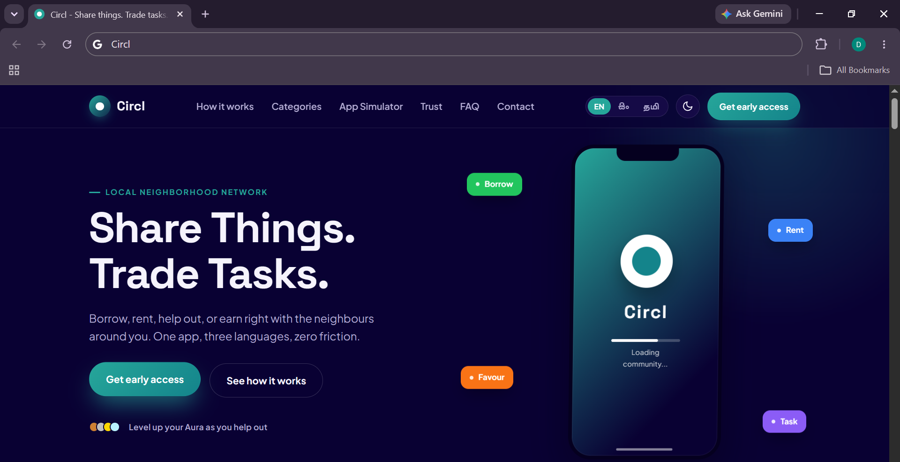
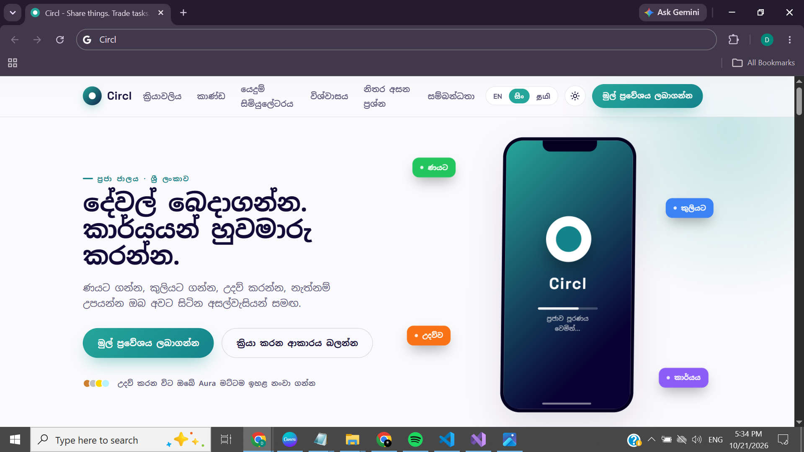
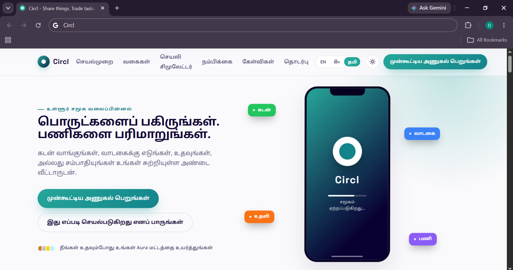
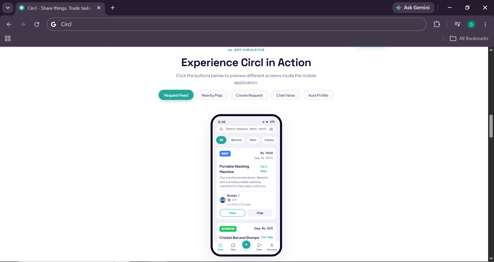
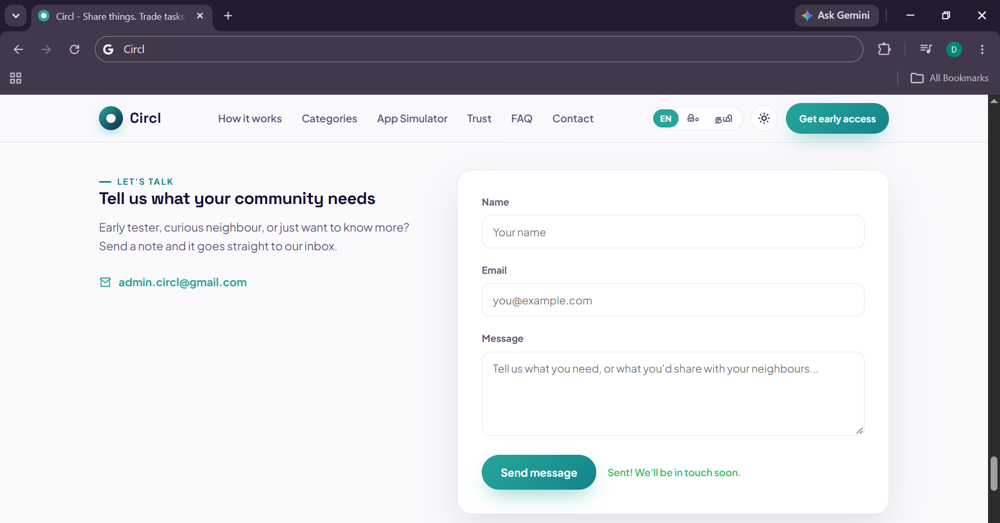

# Circl Web

**App landing website** for **Circl**, a community resource-sharing mobile app.


## What it does

Visitors can click through the mobile interface (Feed, Map, Create Request, Chat, Profile) before downloading anything. The site also supports instant trilingual switching (English, Sinhala, Tamil) and light/dark theming, all without page reloads.

## Tech Stack

- HTML5
- CSS3 (custom properties, absolute positioning)
- Vanilla JavaScript
- Figma (design)
- Google Fonts

## Features

- **Lightweight App Simulator:** clickable phone mockup to explore all five app screens
- **Instant Trilingual Toggle:** English, Sinhala, and Tamil with no page reloads
- **Dynamic Theming:** light/dark mode via a toggle button
- **Custom Animations:** scroll reveals, hover effects, and layout transitions

## Screenshots








## How to run locally

No build tools or backend needed.

```bash
git clone https://github.com/AsfaThahani/CirclWeb.git
cd CirclWeb
